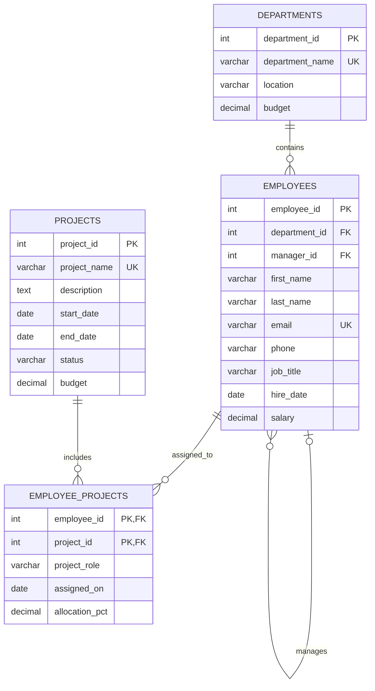

# Employee Management System Database

A normalized SQLite database for departments, employees, projects, and employee project assignments.

## ER diagram



## Relationships and keys

- One department has many employees. `employees.department_id` references `departments.department_id`.
- An employee may manage multiple employees. `employees.manager_id` is a nullable self-reference to `employees.employee_id`.
- Employees and projects have a many-to-many relationship, resolved by `employee_projects`.
- `employee_projects` has a composite primary key of `(employee_id, project_id)`, so an employee has at most one assignment row per project.

## Table definitions

| Table | Purpose | Primary key | Foreign keys |
|---|---|---|---|
| `departments` | Department name, location, and budget | `department_id` | None |
| `employees` | Employee details, department, and reporting manager | `employee_id` | `department_id` → `departments.department_id`; `manager_id` → `employees.employee_id` |
| `projects` | Project details, dates, status, and budget | `project_id` | None |
| `employee_projects` | Employee assignment, role, and allocation on a project | `(employee_id, project_id)` | `employee_id` → `employees.employee_id`; `project_id` → `projects.project_id` |

Unique keys are `departments.department_name`, `employees.email`, and `projects.project_name`. Checks enforce nonnegative budgets and salaries, valid project dates and statuses, and assignment allocations above zero through 100 percent.

## Create table and sample insert scripts

The ready-to-use SQLite database is `employee_management.db` in this folder. Open it with a SQLite client such as DB Browser for SQLite. To create a fresh database, execute `schema.sql` first, then `seed.sql`. `employee_management.sql` contains the combined schema and sample data.

Sample data counts: **5 departments, 20 employees, 10 projects, and 22 employee project assignments.** The scripts insert explicit IDs for readability; integer primary keys can also be generated for new rows.


SQLite-specific script filenames: run SQLLITE_SCHEMA.SQL first to create the tables, then SQLLITE_SEED.SQL to insert sample data.

## InsightSQL application

InsightSQL is a local web application for asking read-only questions about `employee_management.db`. It generates SQL from a curated set of supported natural-language patterns. It does not send database contents or questions to a hosted AI service, and it does not accept arbitrary SQL from the browser.

### Start the application

Requirements: Node.js 20 or newer and npm.

```powershell
npm install
npm start
```

Open [http://127.0.0.1:3000](http://127.0.0.1:3000). Press `Ctrl+C` in the terminal to stop the server. To use another SQLite file, set `INSIGHTSQL_DB` to its full path before running `npm start`.

### Supported question types

- List employees, departments, and projects.
- Filter employees by department, such as “Show employees in Finance”.
- Find employees above or below a salary threshold, or list the highest-paid employees.
- Count employees by department, or get average salary by department.
- Filter projects by status and view employee project assignments.
- Ask for a high-level database summary.

Questions outside these patterns receive examples and a friendly explanation. Result sets are capped at 100 rows. Query history is kept in the current browser's local storage and can be cleared from the sidebar.

### Read-only security

- The SQLite connection opens with `readonly` and `fileMustExist` enabled.
- The server additionally enables SQLite `query_only` and `trusted_schema = OFF`.
- Only exact SQL strings from the application's approved `SELECT` templates can execute. All user values are bound parameters; identifiers and SQL fragments are never taken from the question.
- `DROP`, `DELETE`, `UPDATE`, `INSERT` (including the misspelling `INSETRT`), `ALTER`, and `TRUNCATE` requests are blocked. The server has no endpoint for submitting raw SQL.
- The server binds to `127.0.0.1`, checks local requests, applies response security headers, limits request size, and rate-limits question submissions.
